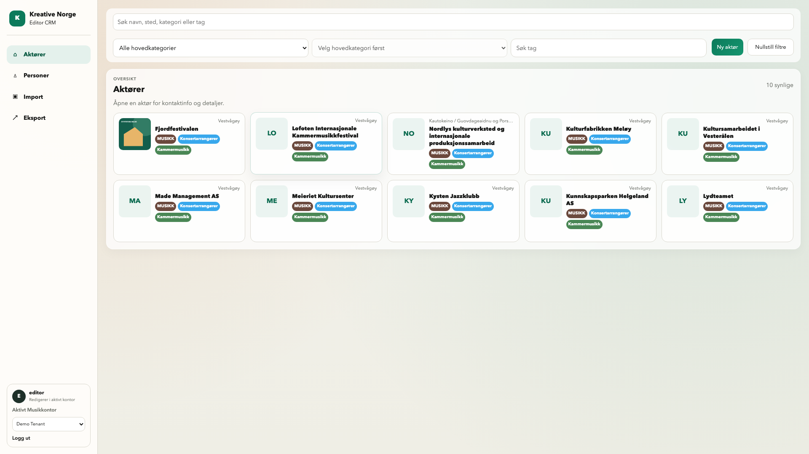
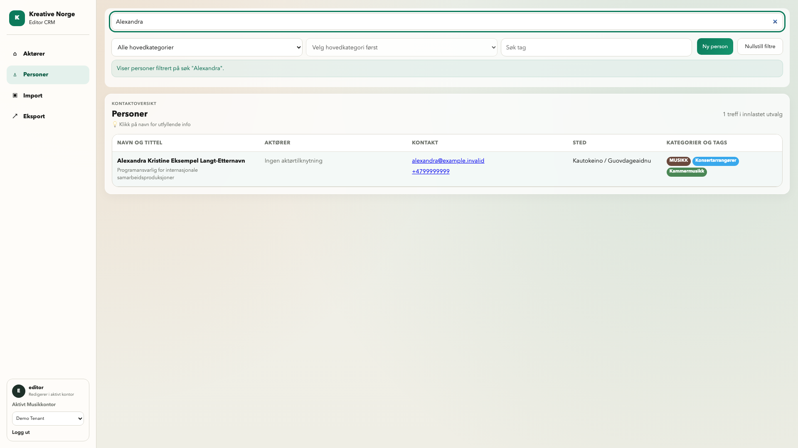

# PR #92 – kvadratiske thumbnails og metadatafarger

**25.10.2026 · RETTET PÅ BRANCH / LOKALT VERIFISERT · SLUTTGODKJENNING GJENSTÅR**

[Åpne kort tilleggsgalleri – ni nye bilder](evidence/editor-colors-2026-10-25/index.html) ·
[Manifest / SHA-256](evidence/editor-colors-2026-10-25/manifest.json) ·
[PR #92](https://github.com/fredrik-stack/kreative-norge-crm/pull/92).

Runtime **`2b4ca8eb96e9e74920b3af5a1ccc6cabf59da24f`**. Bildene er fra faktisk lokal Vite/Chromium med eksplisitt
syntetiske Playwright API-fixtures. De viser gjengivelse, ikke reell backend,
staging eller ny person-/kontaktverifikasjon. Desktop viser hele viewporten
1920×1080, mobil390/320×844; personoversikten på mobil har supplerende fullside.
Dokumentasjonshead kan være nyere uten runtimeendring; siste head/CI følger PR.

## Eierføring og implementert retting

- **Godkjent og låst:** kortenes størrelse fra runde2:148 px høyde, samme responsive
  bredde, min300 når plass finnes og samme kolonner/gap/padding. Thumbnail og
  initialfallback er begge **76×76 px**. Bildet bruker fortsatt object-fit:cover.
- **Farger på tvers:** hovedkategori brun #6b493d, underkategori blå #38a8ec,
  tagg grønn #4a8755. Personoversikten bevarer nå metadataenes typeklasser i egen
  femte kolonne; flat palegrønn overstyring er fjernet. Aktørkort, begge lesemodaler
  og PUBLIC liste/detalj følger samme palett på desktop/mobil. Kategori/underkategori/
  tags er fortsatt faktiske data, ingen ny offentlig/intern klassifisering.
- **Konkrete øvrige fargeavvik:** eksisterende importtabell og åpne forslagsknapper
  får riktig typefarge; stiplet forslagskant, egne kolonner, valg/status og
  lagringsbetjening beholdes. Valgte tags er grønne. PUBLIC-detaljens eldre variant
  hadde brun tagg; én CSS-variabel er rettet til eksisterende grønne. Cutover-
  varianten og listen hadde allerede grønn tagg. Ingen API-/datakontraktendring.
- **Import:** forrige bilde15 er uttrykkelig **avvist av eier som misvisende**.
  Det inngår ikke i dette galleriet eller som vurderingsgrunnlag/designgodkjenning.
  Historisk PNG beholdes; gammel rapport/galleri/manifest er annotert tydelig.
  **Godkjent Import-prototype v6 rev.4/O-24 og godkjent 5E er fortsatt styrende.**
  Ingen ny Import-UX eller påstand om implementert v6. Fargeretting er ikke ny
  gjennomgang av importmodellen. Ingen ny prototype eller formell brukertest.

[UI-6 §12](../features/UI_6_FELLES_SPEC.md#12-låst-kortformat-og-metadatafarger--2026-10-25)
er gjeldende. Øvrige rettelser og manuell personlagring i PR #92 består.

## Verifisering og grenser

| Kontroll | Faktisk resultat |
|---|---|
| Frontend | 66 tester, TypeScript og produksjonsbygg grønne etter siste retting. |
| Editor browser | 24/24 reiser grønne. Fire nye regresjoner: kort/farger ved1920/390/320 og eksisterende importmetadata både lukket/åpen review. Bilde og fallback76×76, kort148/like bredder, ingen sideoverflow; beregnede farger kontrolleres på aktørkort og personoversikt samt begge modaler. |
| PUBLIC browser | Åtte tilfeller: faktiske Django-maler liste/detalj × eldre/cutover-visning ×1920/390. Renderet med syntetisk kontekst i minnet, deretter beregnede farger kontrollert i Chromium. Ingen database/API/stagingkjøring. [Journal](evidence/editor-colors-2026-10-25/public-template-checks.json). |
| Dokumentasjon | Ni PNG og filmanifest med SHA/byte/dimensjoner, lokal galleri-/lenkekontroll. [Kontrolloversikt](evidence/editor-colors-2026-10-25/checks.json). |
| Docker/PostgreSQL | Ikke kjørt og ikke nødvendig i denne runden: bare visning/fargeklasser/mal-CSS, ingen write-/modell-/permissionsendring. Tidligere daterte DB-/lagringsbevis beholdes historisk og påstås ikke kjørt om igjen. |
| Zoom | Ingen ny zoomkjøring; runde2s faktiske 200% er historisk bevis. Ingen endring av profilhandlinger/posisjonering i denne runden. |
| CI/review | Siste-head resultat og eksakte versjoner spores i PR. Agentreview er separat fra gjennomførerens tester og menneskelig eiergodkjenning. |
| Merge/staging | Ikke utført. Samlet sluttgodkjenning kreves fortsatt først. Senere deploy omfatter hele PR-ens API + frontend og PUBLIC-mal, uten migrasjon. |

Tidlig importfixture manglet warnings_json og brukte feil tabellselector; dette
var testoppsett og ble rettet. Separat reviewer fant deretter ett viktig restavvik:
åpne importforslag brukte fortsatt palegrønn farge. Rettet i `2b4ca8eb96e9e74920b3af5a1ccc6cabf59da24f`;
regresjonen åpner nå Review og sjekker alle tre forslagstyper samt valgte tags.
Re-review fant så at mini-pill-klassen utilsiktet krympet forslagsknappene.
Dette er rettet ved å dele bare typefargene; opprinnelig suggestion-pill-geometri
og arvet tekst beholdes. Testen kontrollerer også arvet skrift og klikkhøyde>=30px.
Alle 66/24 kontroller ovenfor er fra siste kode etter rettingen.

Separat skrivebeskyttet kodereview, base `12450066daafd1d71492266f519bd138dba66311`
→ `e02172abf4570f7c8c4993a1675aa0ea8634f81c`, fant bare dette viktige avviket.
Øvrig kort-/person-/PUBLIC-delta hadde ingen kritiske/viktige funn. Re-review fant geometrieresten på `b5d3e9929d7bee396d75d311ce0a16ec4306d254`.
Endelig re-review av `b5d3e99` → `2b4ca8eb96e9e74920b3af5a1ccc6cabf59da24f` bekrefter begge funn lukket,
ingen nye kritiske/viktige funn. Separat dokumentasjons-/evidensreview registreres
med faktiske versjoner/resultater i PR-en. Ingen reviewer-writes, test-/browser-/DB-kjøring.

Ingen endring av kontaktidentitet, primær-/publiseringspolicy, backfill/catch-up,
assignments eller aktivering. Begge Google Maps-aktørkart består i v1. Ingen
ferdigmelding av hele UI-6/6B/6C eller neste produktetappe. Det gjenstående
produktvalget er samlet sluttgodkjenning eller nye konkrete visuelle rettelser.
