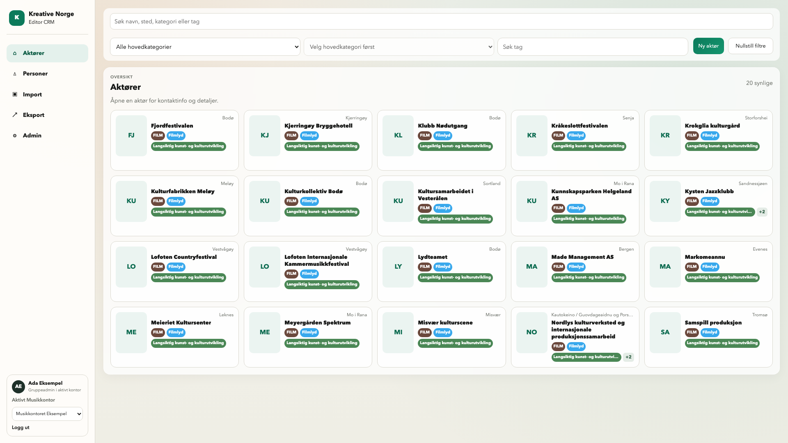
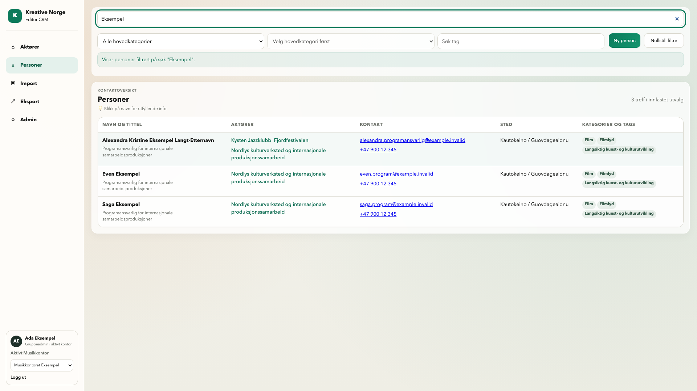
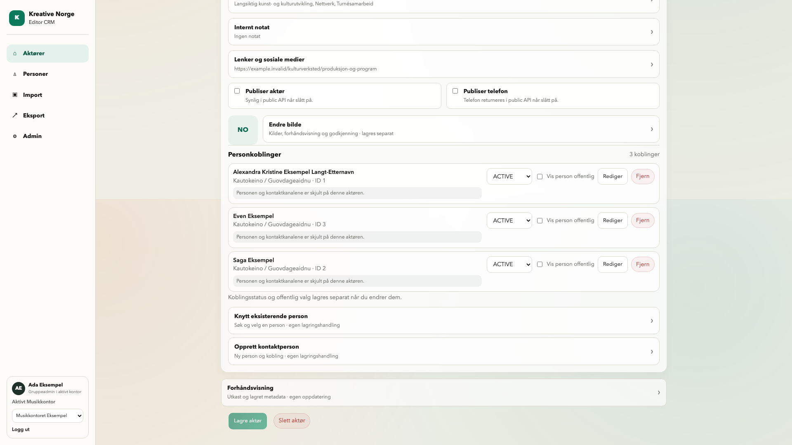

# PR #92 – andre visuelle retting, hele desktopflaten

**Eieravklaring, runde3:** Importbilde15 er avvist som misvisende og er ikke
vurderingsgrunnlag eller godkjent Importdesign. Godkjent v6 rev.4/O-24 styrer.
Kortformatet er godkjent med kvadratiske thumbnails; fargene er rettet i
[nytt avgrenset tillegg](EDITOR_COLOR_VISUAL_REVIEW_2026-10-25.md). Rapporten
nedenfor beskriver historisk runde2 og må leses med denne overstyringen.

**25.10.2026 · IMPLEMENTERT PÅ BRANCH / LOKALT VERIFISERT · SAMLET EIERGODKJENNING GJENSTÅR**

[Åpne det nye bildegalleriet](evidence/editor-layout-2026-10-25/index.html) ·
[Filmanifest / SHA-256](evidence/editor-layout-2026-10-25/manifest.json) ·
[PR #92](https://github.com/fredrik-stack/kreative-norge-crm/pull/92).

Alle **29 nye browserbilder** gjelder runtime
`213219085c3e6da214d372729a1ec91c247a0c6e`. Dokumentasjons-/PR-head kan være nyere
uten runtimeendring; faktisk siste head og CI spores i PR-en. Bildene viser
lokal Vite/Chromium mot isolert Django/PostgreSQL 16 med syntetiske data.
Ingen merge eller staging. Tidligere datert evidens beholdes som historikk.

## Til samlet visuell vurdering

| Eierkommentar | Implementert og vist |
|---|---|
| Kort er for dype / lange navn påvirker raden | Fast 148 px høyde, lik bredde i samme responsive grid, thumbnail 76×100. Navn 13/17 px, inntil tre linjer. Sted øverst til høyre. Full informasjon i lesemodal. |
| Aktørens lagreknapper | Øverst ved profilhodet og helt nederst til venstre etter bilde, personkoblinger og preview. Samme native hovedform, validering og umiddelbare lock. |
| Slett aktør | Gjenopprettet til høyre for nedre Lagre på lagret profil. Eksisterende rolle/confirm/DELETE/409-beskyttelse. Avslag beholder utkast; bare bekreftet sletting tømmer lokal aktør/koblinger. Personer beholdes. |
| Unødvendig kontaktforklaring | Den lange setningen er fjernet. Enkel skjult-status og eksisterende publiseringsregler består. |
| Opprett aktør berører streken | Nederste knapp står etter alle seksjoner med fri luft. |
| Enklere forklaring av personkoblinger | Implementert tekstforslag: «Opprett aktøren først. Deretter kan du knytte til personer eller opprette en ny kontaktperson.» Endelig tekstaksept inngår i samlet visuell godkjenning. |
| Kategorier/tags under personnavnet | Egen femte desktopkolonne på samme rad som navn/tittel, aktører, kontakt og sted. Mobil stables. |
| Ulagrede profilfelt er svart | Oransje dirty-status med tekst, øverst og nederst. Saving/error prioriteres som før. |
| Full desktopbredde/høyde og responsivitet | Primære bilder er viewport 1920×1080. Oversikter/Import bruker arbeidsbredden; profiler er midtstilt innen maks 1080 px. Supplerende fullsidebilder er uttrykkelig merket. |

Styrende [UI-6 §11](../features/UI_6_FELLES_SPEC.md#11-andre-visuelle-retting-av-pr-92--2026-10-25)
overstyrer tidligere kortdybde, fire personkolonner og handlingsplassering.
Import v6 rev.4/O-24 er kontrollert igjen: 200869 byte, SHA-256
`938a40ea725772d96a70fb660a228652070047e3d1d6b3eeebe24aa324499628`.
Eksisterende Editor-fonter består. Ingen ny prototype eller formell brukertestrunde.

## Faktisk validering

| Kontroll | Resultat og grense |
|---|---|
| Frontend | 66 tester grønne, TypeScript og produksjonsbygg grønne på runtime ovenfor. |
| Editor Playwright | 20/20 grønne. Nye regresjoner kontrollerer ytre footer/form, required/URL-validering i lukket seksjon, rolle, confirm, 409 og retur etter sletting. Eksisterende kontakt-/import-/bilde-/navigasjonsreiser består. |
| PostgreSQL/Django | To eksisterende målrettede tester grønne: `LegacyBackfillTests.test_legacy_edit_create_admin_and_api_deletion` og `AssignmentFoundationTests.test_assignment_protects_profile_target_and_legacy_tenant_without_partial_delete`. Ingen ny test-/schema-/backfillkode. |
| Reell browser/API | Lokal oppretting via footer, avbrutt sletting uten DELETE, bekreftet ett DELETE, retur og profilfravær i ny API-lesing. Faktisk redigerer-medlemskap kan ikke slette; gruppeadmin kan. [Journal](evidence/editor-layout-2026-10-25/delete-checks.json). |
| Layout | Like kortmål og ingen kort-/sideoverflow ved 1920/1440/1366/1024/390/320 px. Sted er øverst høyre. Fem personkolonner og kategori/tags utenfor navnecellen, oransje dirty. [Journal](evidence/editor-layout-2026-10-25/checks.json). Personoversikten er i tillegg kontrollert uten sideoverflow ved 1440/1366/1024/390/320. |
| Zoom/fokus | Faktisk Chromium `tabs.setZoom=2`, effektiv viewport 720×456 CSS-px, DPR2, scrollWidth720; telefonfokus er synlig og udekket på aktør/person. [Journal](evidence/editor-layout-2026-10-25/zoom.json). |
| Galleri | Alle 29 PNG lastet i browser; mobil-/zoomfiltre virker. Originaler er tilgjengelige uten beskjæring. |
| CI | Siste publiserte PR-head må ha alle nødvendige grønne kontroller; faktisk run/6 jobber registreres i PR-en. Lokal test er ikke CI. |
| Merge/staging | Ikke utført. Bestillingens §12 krever samlet visuell godkjenning først. Senere deployscope er API + frontend fra hele PR-en, uten ny migrasjon. |

Tidlige regresjonsfeil ble rettet før sluttkontrollen: nye slettefixturetester
trengte eksplisitt gruppeadmin, gammel testtekst fulgte den fjernede setningen,
og aktørvalg `new` etter DELETE utløste feil rutesynk. Siste punkt er rettet til
nullvalg og verifisert både i regresjonstest og mot reell lokal API.

Den eksisterende manuelle personlagringen ble ikke omarbeidet i denne runden.
[Forrige daterte rapport](EDITOR_REVISION_VISUAL_REVIEW_2026-10-25.md) beholder
sine 63 PostgreSQL-tester og kontakt-/delvis-feilbevis på tidligere runtime som
historikk. Disse 63 testene er **ikke** påstått kjørt på ny runtime. Aktuelle
frontendregresjoner kjøres på ny runtime; samlet backend/PUBLIC-CI følger PR.

## Bevisgrenser og review

Bildene 01–15 er uten responsendring. Bildene 16 og 17-serien bruker én eksplisitt
kontrollert syntetisk bilde-URL i ellers reell aktørleserespons for å vise bilde
og fallback sammen. En syntetisk SVG leveres i testtransporten. Dette beviser
frontendens kortgjengivelse, ikke publisert bilderelease, PUBLIC eller staging.
Øvrige profil-/personbilder bygger på faktiske lokale data og API-lesing.
Ingen rå reelle persondata, innloggingsdata, cookies eller tokens er publisert.

Faktisk separat skrivebeskyttet kodereview: base
`f146a5eb80d60b602d07f4c58addff2804feb043` → runtime
`213219085c3e6da214d372729a1ec91c247a0c6e`, **ingen kritiske eller viktige funn**.
Reviewer kontrollerte form/validering, Save/Delete-lock, roller/confirm/409,
cachegrense og nullvalg/retur, fem kolonner/status og åtte representative bilder,
inkludert 320 px, mobilfooter og zoom. Reviewer kjørte ingen tester/browser/DB
og utførte ingen writes. Dokumentasjon/evidens får separat versjonsbundet review;
endelig resultat spores i PR-en. Egenkontroll er ikke omtalt som uavhengig review.

Rolle-/API-/telefon-/datamodelldokumentasjonen er kontrollert: eksisterende
DELETE-roller, tenantavgrensning, beskyttet profil og manuell kontaktkontrakt
består. Ingen backenddelta i denne andre runden; hele PR-ens tidligere additive
Session/Login-endring består. Ingen kontakt-/primær-/publiserings-/taggpolicy,
ny assignment, catch-up/backfill eller aktivering. Begge Google Maps-aktørkart,
godkjent 5E og øvrig v1-plan består. Hele UI-6/6B/6C ferdigmeldes ikke.

Det eneste gjenstående eiervalget er samlet visuell godkjenning eller konkrete
rettelser, inkludert tekstforslaget for personkoblinger. Ingen implementering av
neste etappe starter automatisk. Lokale taskressurser og auth-state ryddes før
overlevering; faktisk sluttstatus rapporteres i SESSION WRAP-UP/PR-en.
