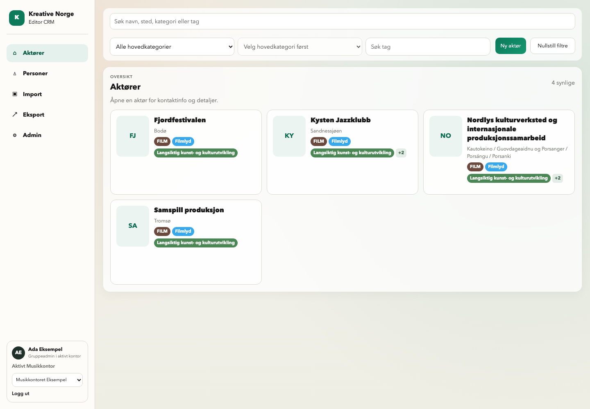
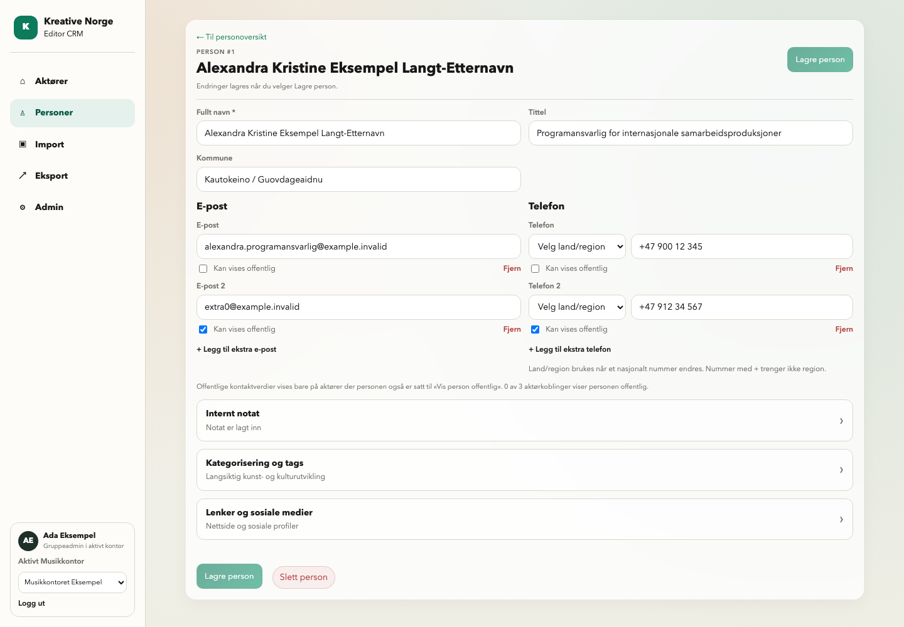

# PR #92 – samlet visuelt grunnlag etter eiergjennomgang

**25.10.2026 · RETTET KODE / LOKALT VERIFISERT · NY SAMLET EIERGODKJENNING GJENSTÅR**

[Åpne hele bildegalleriet](evidence/editor-revision-2026-10-25/index.html) ·
[alle filer/kontrollsummer](evidence/editor-revision-2026-10-25/manifest.json) ·
[PR #92](https://github.com/fredrik-stack/kreative-norge-crm/pull/92).

Alle de 38 bildene gjelder runtime **`2cd0e18ad103d6af694d43335c4293faed26b03a`**, kjørt lokalt med
syntetiske profiler/brukere mot isolert Django/PostgreSQL 16 og Vite/Chromium.
PR-/dokumentasjonshodet kan være nyere uten runtimeendring; kontroller diff og
GitHub Checks. Bildene fra 24.10 på `caccd8b` er bevart som historisk evidens og
brukes ikke som bevis for denne rettingsrunden. Ingen merge, staging eller ny
samlet visuell godkjenning er utført/påstått.

## Til samlet visuell beslutning

Godkjent aktørmodal, åpen bildeflyt desktop/mobil, søk-først-inngang og sann
statusretning videreføres. Nytt grunnlag dekker meny/brukerpanel, like kortmål,
manuelle kontaktgrupper, topp-/bunnhandlinger og tettere skjema. Styrende
[UI-6 §10](../features/UI_6_FELLES_SPEC.md#10-eierbestilt-retting-av-pr-92--2026-10-25)
beskriver implementert scope og overstyrte eldre anbefalinger. Begge kart i v1,
Import v6 rev.4/O-24 og godkjent 5E består. Ingen ny formell brukertest.

## Kontroller og bevisgrenser

| Kontroll | Faktisk resultat |
|---|---|
| Frontend | 64 tester grønne; TypeScript og produksjonsbuild grønne på rettet kode |
| Editor Playwright | 18 reiser grønne, inkludert ny person/kontaktfeil/retry/ID-bevaring og navigasjon |
| Django/PostgreSQL | 63 målrettede tester grønne: ny auth-/kontaktsekvens, eksisterende auth, kontakt/primary/telefon og PUBLIC-publiseringsregler |
| Reell browser/backend | 12 hovedkontroller og 4 supplerende kontroller; [journal](evidence/editor-revision-2026-10-25/checks.json), [tillegg](evidence/editor-revision-2026-10-25/extra-checks.json) |
| Bredder/fokus | 1440, 1366, 1024, 390 og 320 CSS-px; like kortmål, ingen sideoverflow, synlig telefonfokus og region før nummer |
| Faktisk zoom | Chromium tabs.setZoom=2; effektiv viewport 720×456 CSS-px, DPR2, scrollWidth720; [journal](evidence/editor-revision-2026-10-25/zoom.json) |
| CI | Nødvendige kontroller på siste publiserte PR-head må være grønne; faktisk run/status registreres i PR-en |
| Merge/staging | Ikke utført; krever først ny samlet visuell eiergodkjenning etter bestillingens §12 |

De reelle kontrollene bruker eksisterende API-er, ikke bare mocks. Tittel-only
bevarer alle fire kontakt-ID-er, tekniske primær-/offentligflagg og telefonidentitet,
med email/phone utelatt fra PATCH. Blur, offentlige valg og tillegg gir ingen
writes før Lagre. Kontakt-dirty verner meny, tenant og logout. Profil-PATCH etterfulgt
av kontrollert kontakt-403 beholder form/utkast; retry lykkes uten ny kontakt.
Ny Person-POST og ekstra e-post-POST etterfulgt av avvist telefon-POST beholder ID-ene;
retry gir én person med to e-poster/to telefoner. Eksplisitt primærfjerning bruker
DELETE-ID før tømming av hovedfelt og oppgraderer ingen ekstra kontakt.

Ved ukjent POST-utfall er et **ekte vellykket serverkall** utført med route.fetch,
mens svaret deretter er forkastet i testtransporten. UI blokkerer både ny submit og
Lagre og fortsett; bare ett POST er sendt i hvert scenario. Ingen automatisk
identitetsmatching etter navn/verdi brukes. Avslag/delay i statusbildene er kontrollerte
transportscenarioer; dette er ikke påstander om feil i staging.

Bildene 36–37 er en tydelig merket **visuell fixture**: én bilde-URL og ett ekstremt
navn i en ellers reell aktørleserespons er kontrollert i browseren. Selve bildet er
syntetisk SVG. Dette viser bilde/fallback og tekstklipping i faktisk frontendkode,
men verifiserer ikke bildebackend, rettigheter eller PUBLIC-release. Hovedbildene
bruker reelle lokale API-responser. Bildearbeidsflytens eksisterende 18 komponenttester
og fem kandidat-/prosess-/godkjenningsreiser inngår i regresjonene.

Modalbilder er viewportfangst (1440×1000 eller 390×844), ikke fullPage-bilder som kan
skjule plasseringen i skjermbildet. Øvrige fullPage-bilder viser hele dokumentflyten;
topp/bunn og lagringstilstander har også viewportbilder. Zoom-PNG-ene er 1440×913
fysiske piksler, hentet direkte med CDP Page.captureScreenshot uten clip ved faktisk
zoom 2. Dette unngår Playwrights klipping ved native zoom. Fokus er først kontrollert
innen viewport og uten overdekking; bildet tas etter fonts.ready/to animation frames.

Ingen formell brukeraksept, staging-/Cloudflare-/produksjonsverifikasjon, ny
bildeprovider eller PUBLIC-UI/kartkontroll utledes av disse lokale bevisene.

## Særlige kontraktgrenser og rettede reviewfunn

- Region-only på lagret persontelefon spores som dirty og avvises før writes/
  videreføring fordi dagens backend bare normaliserer når nummerverdien endres.
  Dette gjelder også legacy Person.phone uten primærkontakt. Urørt effektiv
  defaultregion/whitespace starter ren; ingen kontaktreparasjon utføres.
- Angre gjelder bare ennå uskrevet fjerning. Bekreftet/ukjent DELETE kan ikke
  angres lokalt; retry bruker samme kjente ID, aldri POST. Ved forkasting med
  ukjent DELETE/ufullført hovedfeltklarering bevares en session-ref per tenant/
  person. Usikre rader/gammel hovedfeltfallback skjules og nye writes sperres
  til fersk ordinær innlasting, også etter internt bytte tilbake. Fjern→Angre
  før writes gjenoppretter opprinnelig utkast uten å reparere et legacyavvik.
- Flere API-kall er sekvensielle. Ingen atomisk total-lagring, rollback av
  vellykkede kall eller varig idempotencykontrakt er innført.

## Faktisk separat kode-review

Reviewer `editor_compact_review` brukte `$gjennomga-siste-endring` skrivebeskyttet;
reviewer endret ingen filer/PR og kjørte ingen tester/browser/database.

| Review | Grunnlag | Resultat |
|---|---|---|
| Første korrigeringsreview | `4bf4bcd` → `399453a` | To viktige funn: region-only og delvis DELETE/undo/cache |
| Relevant re-review | `399453a` → `c243dd4` | DELETE/identitets-/savingfunn lukket; én legacy-regionrest |
| Relevant siste kode-review | `c243dd4` → `2cd0e18ad103d6af694d43335c4293faed26b03a` | Restfunnet lukket; ingen nye kritiske/viktige funn |

Samlet PR-base er `4e9340f0f606e95e0bc8603916b7acd4f7e93008`.
Reviewkonklusjonene er versjonsbundet og bekrefter ikke CI eller visuell eieraksept.
Siste dokumentasjons-/evidensreview og siste CI-status registreres i PR-en uten
å lage ny dokumentasjonscommit bare for å registrere CI-utfallet.

## Levering, opprydding og neste gate

Samme draft PR #92. Påkrevd siste PR-CI, separat review av publisert dokumentasjon/
evidens og én samlet eierbeslutning før merge/staging. Den minimale additive
Session/Login-utvidelsen gjør senere deployscope til **API + frontend**, uten ny
migrasjon. Etter uttrykkelig godkjenning følges ordinær merge, main-CI og stagingrunbook.
Ingen automatisk oppstart av 6B/6C, ny policy, backfill, eksportmotor eller kart.

De lokale testserverne, den egne PostgreSQL-containeren og privat auth-/bildeteststate
skal ryddes etter evidens-/reviewkontrollen. Sluttkontroll og faktisk opprydding
rapporteres i SESSION WRAP-UP. Eksisterende lokale containere/volumer og staging
berøres ikke. Ingen autentiseringscookies, passord, rå reelle kontaktdata eller
private eierreferansebilder følger denne evidensleveransen.

## Alle nye bilder

| Bilde | Visning |
|---|---|
| [Desktop: venstremeny, faktisk bruker/rolle/kontor og like kortmål](evidence/editor-revision-2026-10-25/01-desktop-shell-cards.png) | 1440×1000 |
| [Aktørmodal: faktisk viewport og alle tags](evidence/editor-revision-2026-10-25/02-actor-modal-viewport.png) | 1440×1000 |
| [Rediger aktør: topphandling i viewport](evidence/editor-revision-2026-10-25/03-actor-edit-top.png) | 1440×1000 |
| [Rediger aktør: hele siden uten tom previewkolonne](evidence/editor-revision-2026-10-25/04-actor-edit-full.png) | 1440×1681 |
| [Rediger aktør: nedre handling i viewport](evidence/editor-revision-2026-10-25/05-actor-edit-bottom.png) | 1440×1000 |
| [Åpen bildeflyt: desktop, hele siden](evidence/editor-revision-2026-10-25/06-image-workflow-full.png) | 1440×2020 |
| [Ny aktør: topp og bunn i samme form](evidence/editor-revision-2026-10-25/07-new-actor-full.png) | 1440×1151 |
| [Personer: søk-først-inngang](evidence/editor-revision-2026-10-25/08-people-search-entry.png) | 1440×1000 |
| [Personer: fire grupper med kategori-/taggmetadata og hint](evidence/editor-revision-2026-10-25/09-people-results-metadata.png) | 1440×1000 |
| [Personmodal: faktisk viewport uten Knyttet-indikator](evidence/editor-revision-2026-10-25/10-person-modal-viewport.png) | 1440×1000 |
| [Rediger person: 2 e-poster/2 telefoner og ulike offentlige valg](evidence/editor-revision-2026-10-25/11-person-edit-full.png) | 1440×1000 |
| [Rediger person: topphandling i viewport](evidence/editor-revision-2026-10-25/12-person-edit-top.png) | 1440×1000 |
| [Rediger person: bunnhandling til venstre for sletting](evidence/editor-revision-2026-10-25/13-person-edit-bottom.png) | 1440×1000 |
| [Person: endringer før lagring](evidence/editor-revision-2026-10-25/14-person-changed.png) | 1440×1000 |
| [Person: lagring pågår](evidence/editor-revision-2026-10-25/15-person-saving.png) | 1440×1000 |
| [Person: hele lagringen bekreftet](evidence/editor-revision-2026-10-25/16-person-saved.png) | 1440×1000 |
| [Person: profilwrite bekreftet, kontaktwrite avvist](evidence/editor-revision-2026-10-25/17-person-partial-error.png) | 1440×1000 |
| [Ny person: lokale ekstra e-post-/telefonrader](evidence/editor-revision-2026-10-25/18-new-person-multicontact-full.png) | 1440×1000 |
| [Ny person: ID-er beholdt etter senere kontaktfeil](evidence/editor-revision-2026-10-25/19-new-person-partial-error.png) | 1440×1000 |
| [Aktør: endringer før lagring](evidence/editor-revision-2026-10-25/20-actor-changed.png) | 1440×1000 |
| [Aktør: lagring pågår](evidence/editor-revision-2026-10-25/21-actor-saving.png) | 1440×1000 |
| [Aktør: lagring bekreftet](evidence/editor-revision-2026-10-25/22-actor-saved.png) | 1440×1000 |
| [Aktør: lagring ikke bekreftet](evidence/editor-revision-2026-10-25/23-actor-error.png) | 1440×1000 |
| [Mobil: kompakt meny og like kortmål](evidence/editor-revision-2026-10-25/24-mobile-shell-cards.png) | 390×1514 |
| [Mobil aktørmodal: faktisk viewport](evidence/editor-revision-2026-10-25/25-mobile-actor-modal-viewport.png) | 390×844 |
| [Mobil: rediger aktør, hele siden](evidence/editor-revision-2026-10-25/26-mobile-actor-edit-full.png) | 390×2807 |
| [Mobil: åpen bildeflyt, hele siden](evidence/editor-revision-2026-10-25/27-mobile-image-workflow-full.png) | 390×3196 |
| [Mobil: rediger person med ekstra rader](evidence/editor-revision-2026-10-25/28-mobile-person-edit-full.png) | 390×1739 |
| [Mobil: personresultater med metadata](evidence/editor-revision-2026-10-25/29-mobile-people-results.png) | 390×1074 |
| [Mobil personmodal: faktisk viewport](evidence/editor-revision-2026-10-25/30-mobile-person-modal-viewport.png) | 390×844 |
| [Mobil: ny person med lokale ekstra rader](evidence/editor-revision-2026-10-25/31-mobile-new-person-full.png) | 390×1710 |
| [Import: egen eksisterende arbeidsflate](evidence/editor-revision-2026-10-25/34-import-desktop.png) | 1440×1000 |
| [Eksport: egen arbeidsflate med ærlig funksjonsstatus](evidence/editor-revision-2026-10-25/35-export-desktop.png) | 1440×1000 |
| [Kort: kontrollert bildeprojeksjon og ekstremt navn, desktop](evidence/editor-revision-2026-10-25/36-cards-image-extreme-fixture-desktop.png) | 1440×1000 |
| [Kort: kontrollert bildeprojeksjon og ekstremt navn, mobil](evidence/editor-revision-2026-10-25/37-cards-image-extreme-fixture-mobile.png) | 390×1514 |
| [Faktisk ikke-staff leser: navn/rolle og fravær av Admin/skrivevalg](evidence/editor-revision-2026-10-25/38-reader-role-desktop.png) | 1440×1000 |
| [Aktør: faktisk 200 % zoom, fokus og region/nummer i viewport](evidence/editor-revision-2026-10-25/actor-zoom200.png) | 1440×913 |
| [Person: faktisk 200 % zoom, fokus og region/nummer i viewport](evidence/editor-revision-2026-10-25/person-zoom200.png) | 1440×913 |
