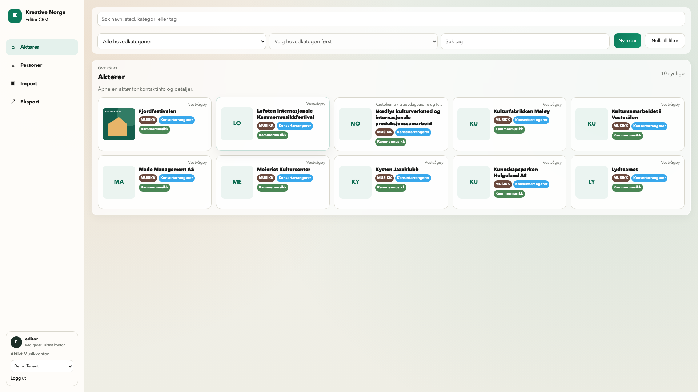
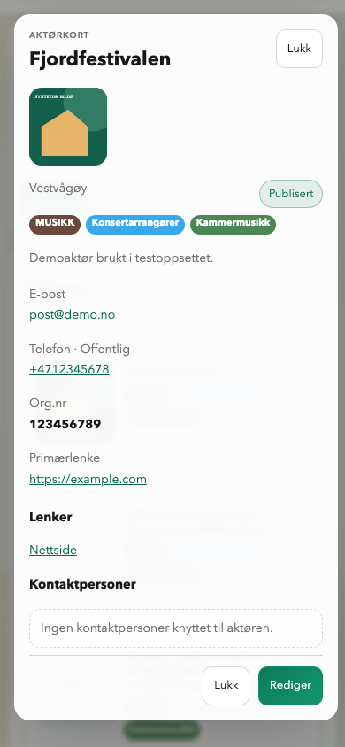

# PR #92 – sentrert thumbnail og aktørmodal på mobil

**25.10.2026 · KODE / LOKALT VERIFISERT · SAMLET SLUTTAKSEPT GJENSTÅR**

[Åpne seks nye viewportbilder](evidence/editor-thumbnails-2026-10-25/index.html) ·
[manifest/SHA-256](evidence/editor-thumbnails-2026-10-25/manifest.json) ·
[PR #92](https://github.com/fredrik-stack/kreative-norge-crm/pull/92).

Runtime **`7ef04b1646dd7466f69b3494ff507e579553b346`**. Alle bilder viser faktisk lokal Vite/Chromium med
syntetiske Playwright API-fixtures. Ingen reell backend/database/staging er brukt
i denne runden. Desktop1920×1080 og mobil390/320×844 er hele viewporten, ikke
fullside eller beskåret panel. Ved320px er modalens innhold rullet til footeren,
slik at grønn Rediger vises. Dokumentasjonshead kan være nyere uten runtimeendring.

## Rettet mot eiers kommentarer

- Editor bruker nå **90×90px** bilde og fallback, samme mål som faktisk PUBLIC-
  listemal (som er uendret). Kun thumbnail-kolonnen endres fra76 til90px.
  Bilde/fallback er sentrert vertikalt til venstre i hele kortet, på desktop/mobil.
- Godkjent kort148px, responsive bredde/kolonner, padding, gap og skrifter beholdes.
  Tekst/sted beholder plassering. Hovedkategori får beholde bredde på smal skjerm,
  så «MUSIKK» ikke forkortes fordi thumbnailen er større. Lange øvrige verdier
  har eksisterende kontrollert avkorting og full informasjon i lesemodalen.
- Aktørmodalen har eget viewportbilde på alle tre bredder med **grønn Rediger**
  synlig. Knappen var allerede en primary-handling under eksisterende canWrite;
  ingen modalkodeendring eller ny tilgang. Klikk er testet til riktig aktørredigering.

[UI-6 §13](../features/UI_6_FELLES_SPEC.md#13-thumbnail-som-public-og-aktørens-mobilmodal--2026-10-25) er gjeldende eierføring.
Tidligere76px-bilder beholdes som historikk, ikke som bevis for denne rettingen.
Import er ikke med i vurderingsgrunnlaget. Godkjent prototype v6 rev.4/O-24/5E
og tidligere metadatafarger/personlagring består. PUBLIC brukes kun som referanse.

## Faktisk kontroll og bevisgrenser

| Kontroll | Resultat |
|---|---|
| Frontend |66 tester, TypeScript og produksjonsbygg grønne. |
| Editor-reiser |24/24 grønne etter siste retting. Tre eksisterende browserkontroller er utvidet med90px kvadrat, thumbnailens vertikale senteravvik<0,5CSSpx, samme kort148/lik bredde og hovedkategori uten klipping. Eksisterende øvrige reiser består. |
| Aktørmodal |Ved1920/390/320: eksisterende grønn gradient, synlig og innen viewport, udekket trykkpunkt, Rediger åpner /organizations/10; retur fungerer. Samme rolleport i kildekoden. Ingen ny backend-/rettighetsverifikasjon påstås. |
| Evidens |Seks originale viewport-PNG, faktiske dimensjoner og SHA/bytes i manifest, eksplisitte syntetiske data. [Kontrolljournal](evidence/editor-thumbnails-2026-10-25/checks.json). |
| Docker/DB/zoom |Ikke kjørt/ikke nødvendig for denne CSS-/browserrettingen. Tidligere DB-/zoomkontroller i daterte rapporter er historiske og påstås ikke gjentatt. |
| Review/CI |Faktisk separat skrivebeskyttet review og siste-head CI spores med eksakte versjoner i PR-en. Lokal kontroll er ikke CI eller menneskelig godkjenning. |
| Merge/staging |Ikke utført; samlet sluttgodkjenning kreves først. Senere scope for hele PR-en er API+frontend uten migrasjon. |

Tidlige måleasserts ble korrigert: knappen bruker eksisterende grønn gradient,
ikke solid background-color, og hover-transform gir små flyttallsavvik i browserens
rektangler. Kortmål avrundes tilCSS-piksel; thumbnail90 kontrolleres til0,01CSSpx,
sentrering til<0,5px. Dette er målepresisjon, ingen endring av knapp eller kortmål.
Sluttkjøring av alle 24 reiser er grønn; første mislykkede kjøringer er ikke sluttbevis.

Produksjonsdeltaet er kun tre CSS-regler for aktøroversikten; eksisterende modal,
API, lagringsflyt, data, permissions og PUBLIC-mal er uendret. Ingen ny feature,
tag-/publiseringspolicy, assignment/backfill eller produktetappe. Begge kart består
som avtalt v1. Det gjenstående eiervalget er samlet sluttaksept eller konkrete rettelser.

Separat skrivebeskyttet kodereview gjelder base
`ac26bf0b8b1831bc093b1fc723ccd14af4a292f4` → runtime
`7ef04b1646dd7466f69b3494ff507e579553b346`: ingen kritiske/viktige funn.
Reviewer kontrollerte CSS, testdekning og alle seks bilder, uten test-/browser-/
DB-kjøring eller mutasjoner. Dokumentasjon/evidens får eget versjonsbundet review;
resultat og siste-head CI registreres i PR-en før overlevering.
